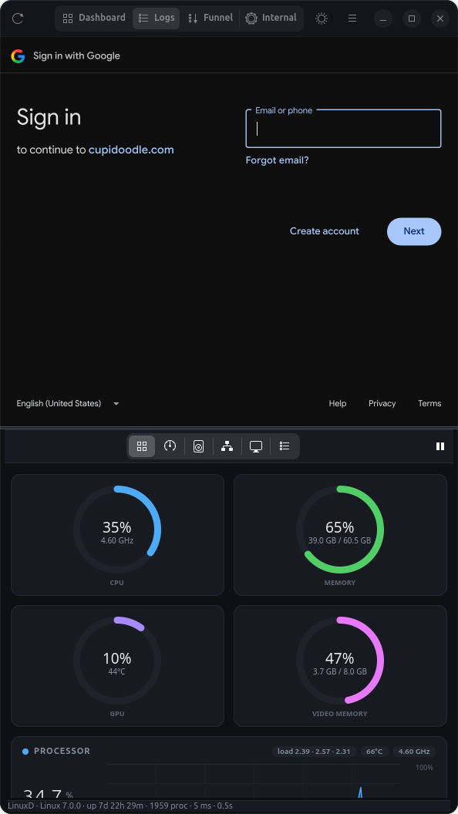
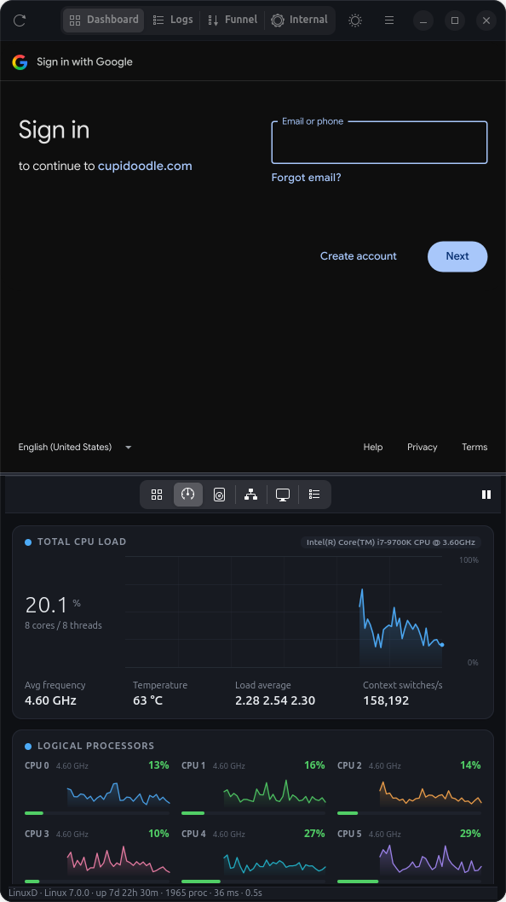
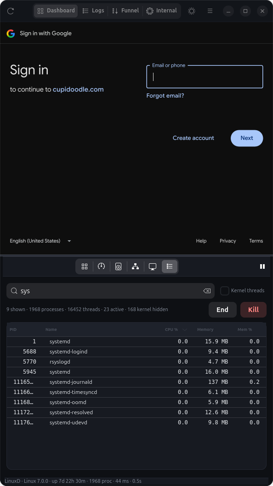
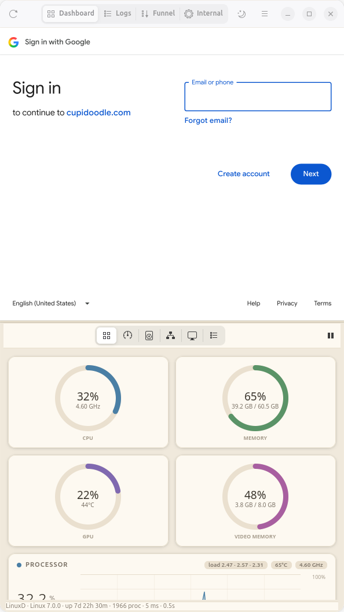
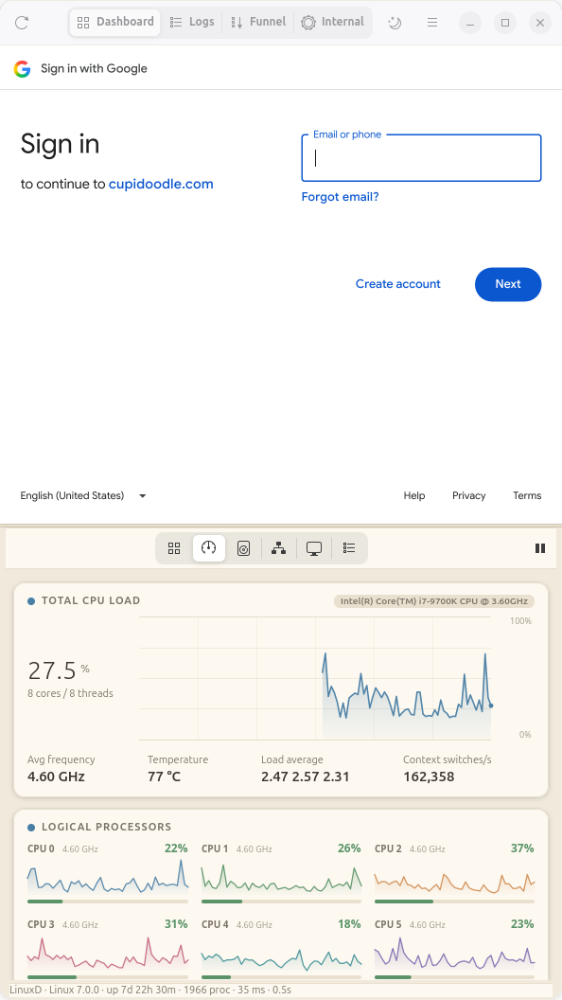
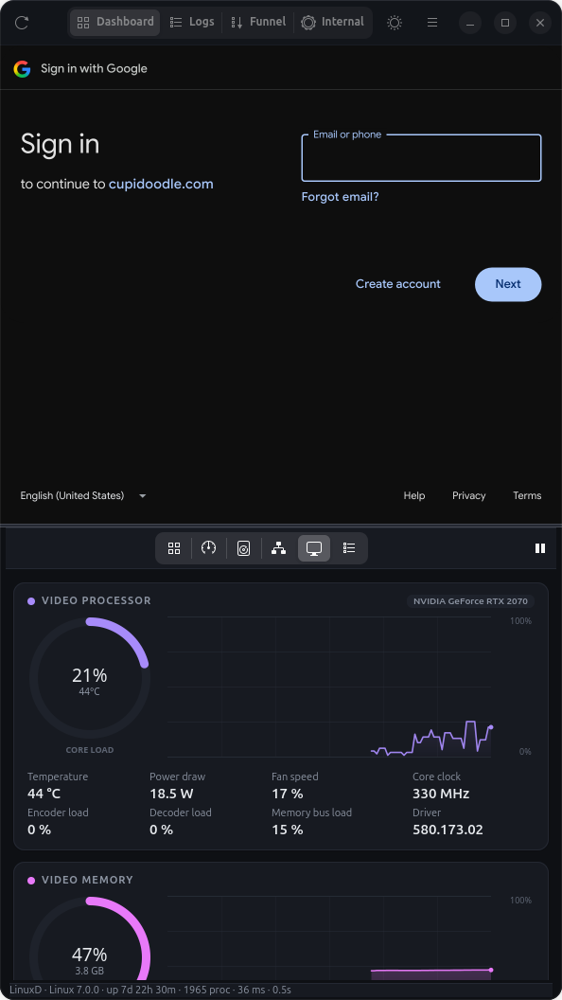

# Vitals

A 9:16 portrait desk panel for Linux. The top half is an internal web console
with four tabs (Dashboard, Logs, Funnel and Internal); the bottom half is a
real-time system monitor covering CPU per core, memory, swap, network, disk,
processes and GPU — including video processor load and video memory.

Built with GTK4 + libadwaita, WebKitGTK and PyGObject. Charts are drawn directly
with GSK, so there is no charting dependency and rendering is GPU-accelerated.

<p align="center">
  
  
  
</p>
<p align="center">
  
  
</p>

## Layout

The window opens as a 9:16 portrait sized to the screen it lands on, split in
half by a draggable divider:

🌐 **Web console (top)** — four tabs: `internal/dashboard` (the one it opens on),
`internal/logs`, `internal/selling-funnel` and `internal`. They share one
browsing session, so signing in once covers all of them and the login survives a
restart. A thin progress bar tracks loading, and HTTP errors get a readable
screen with retry and sign-in buttons instead of a blank page.

📈 **System monitor (bottom)** — the six pages below, on an icon switcher.

Drag the divider to give either half more room, or use **Even split** and
**Reset to 9:16** in the menu. `--monitor-only` starts without the web half.

## Themes

Dark and light, switched with the sun/moon button in the header bar, `Ctrl+T`,
or **Light theme** in the menu. The choice is remembered in
`~/.config/vitals/settings.json`.

The light theme is a warm cream monitor with dusty pastel accents rather than
white with saturated ones. It covers the monitor half only: the header bar and
the surface behind the web console stay neutral, so the pages up there look the
way they were designed to. The web console still follows light or dark, since
its pages read the preference the desktop reports.

Both palettes are in `vitals/theme.py`. Accents are picked per palette rather
than shared, because hues tuned for thin lines on near-black go washed out on a
pale card. Two details worth knowing before editing it:

- Charts hold on to the color they were built with, so palette entries are
  tokens that resolve on every use — a `theme.CPU` handed to a chart at startup
  still follows a later switch. Pass tokens, not hex strings, to anything that
  keeps a color.
- The monitor pane sets libadwaita's own color variables on itself, which is how
  stock widgets inside it (the process search entry, the buttons) end up on the
  same palette as the cards without the web half being affected.

## Monitor pages

📊 **Overview** — CPU, memory, GPU and video memory gauges at a glance, plus
live graphs for processor, memory/swap, network, video and disk I/O.

🧠 **CPU** — total load with history, a tile per logical processor (load, live
graph and per-core frequency), temperature, load average, context switches, and
the top CPU consumers.

💾 **Memory** — physical memory composition (apps / cache / free), swap usage
with swap-in and swap-out rates, and usage of every mounted filesystem.

🌐 **Network** — total throughput plus a card per interface with download and
upload rates, cumulative totals, link speed and IPv4 address.

🎮 **GPU** — core load, temperature, power draw, fan speed, clocks, encoder and
decoder utilisation, video memory usage, and the processes holding video memory.

📋 **Processes** — every process with CPU, memory, VRAM, thread count and state.
Sortable by any column, searchable, and able to end or kill a selected process.

Every page reflows to the width available: cards stack, stat grids drop columns,
and the process table hides its least useful columns in a narrow window and
brings them back when you widen it.



## Requirements

- Linux (process and CPU statistics are read from `/proc`)
- Python 3.10+
- GTK 4 and libadwaita with PyGObject
- WebKitGTK 6.0 introspection data, for the web console
- `psutil`
- Optional: NVIDIA driver with `nvidia-smi` for GPU metrics

On Ubuntu these are already present on a standard GNOME install, except:

```bash
sudo apt install python3-gi python3-psutil gir1.2-gtk-4.0 gir1.2-adw-1 \
                 gir1.2-webkit-6.0
```

Ubuntu ships the WebKit library itself but leaves out `gir1.2-webkit-6.0`,
which is what PyGObject needs. If you cannot install packages, unpack just that
introspection data into `vendor/` without root:

```bash
./tools/setup_webkit.sh
```

Without it the monitor still runs and the top half explains how to enable
itself, with buttons to open both URLs in your browser.

GPU metrics use `nvidia-smi`. Without a supported GPU the app runs normally and
the GPU page explains that no telemetry was found.

## Running

```bash
python3 main.py                # web console + monitor
python3 main.py --monitor-only # monitor only
```

To install a desktop launcher for the current user:

```bash
./install.sh
```

## Keyboard shortcuts

| Shortcut | Action |
| --- | --- |
| `Alt+1` – `Alt+4` | Switch to the Dashboard, Logs, Funnel or Internal tab |
| `Ctrl+R` | Reload the current web tab |
| `Alt+←` | Go back in the current web tab |
| `Ctrl++`, `Ctrl+-`, `Ctrl+0` | Zoom the web console in, out, or back to default |
| `Ctrl+1` – `Ctrl+6` | Jump to Overview, CPU, Memory, Network, GPU or Processes |
| `Ctrl+Space` | Pause or resume updates |
| `Ctrl+T` | Switch between the light and dark theme |
| `Ctrl+F` | Search the process list |
| `F5` | Refresh the monitor immediately |
| `Ctrl+Q` | Quit |

Shortcuts use modifiers so that plain typing goes to the web page. The refresh
interval (0.5 s to 3 s) is set from the menu in the header bar.

## How it works

Sampling is deliberately cheap so the monitor does not distort what it measures:

- Process data comes from a single `/proc/<pid>/stat` read per process, which
  yields state, CPU time, thread count and resident memory at once. CPU percent
  is computed from the tick delta between scans.
- Per-process values that never change (name, user, whether it is a kernel
  thread) are resolved once and cached for the lifetime of the PID.
- `psutil`'s sensor scan is by far the most expensive whole-system call, so
  temperatures are polled on a slower cadence than everything else.
- GPU metrics come from one long-lived `nvidia-smi` process in loop mode, read
  on a background thread, rather than spawning a process per tick.
- The process table is only refreshed while its page is visible; other pages
  need just the counters.
- Web tabs load on first use, so the other web processes only start when you
  switch to them.

Measured on a machine with ~1850 processes: about 4 ms per tick for the
whole-system metrics and about 34 ms when the full process list is included.

Kernel threads are hidden by default. They are always idle and add hundreds of
rows; the checkbox in the process toolbar shows them.

One GTK4 detail worth knowing if you extend the layout: overriding
`do_size_allocate` on a `Gtk.Box` or `Gtk.Grid` subclass is never called, since
their layout manager owns allocation. Responsive containers here keep a
zero-height `ui.width_probe()` child and listen to its `resize` signal instead.

## Project layout

```
main.py              launcher
vitals/
  bootstrap.py       makes the WebKit typelibs importable
  config.py          app identity, web tab URLs, refresh rates
  prefs.py           the remembered theme choice
  app.py             portrait window, actions, tick loop
  webpane.py         web console: tabs, session, error handling
  monitor.py         monitor half: pages and switcher
  sampler.py         metric collection and rolling history
  gpu.py             NVIDIA telemetry backend
  theme.py           light and dark palettes, stylesheet, formatting
  draw.py            GSK drawing primitives
  widgets.py         charts, gauges, bars, core tiles
  ui.py              cards, responsive grids, layout helpers
  pages/             one module per monitor page
tools/               development helpers (setup, benchmarks, checks, shots)
vendor/              locally unpacked WebKit typelibs (git-ignored)
```

## Development helpers

```bash
./tools/setup_webkit.sh                # unpack WebKit typelibs into vendor/
python3 tools/bench.py                 # time the sampling paths
python3 tools/test_proc_parse.py       # cross-check /proc parsing vs psutil
python3 tools/test_process_render.py   # verify the table renders correct rows
python3 tools/capture.py /tmp/shots    # screenshot every tab and page, both themes
```

## Changing the URLs

The tabs live in `vitals/config.py`, in the order they appear. The first entry is
the tab the window opens on, and `Alt+<n>` follows the same order:

```python
TABS = (
    ("dashboard", "Dashboard", "view-grid-symbolic",
     "https://cupidoodle.com/internal/dashboard"),
    ("logs", "Logs", "view-list-symbolic",
     "https://cupidoodle.com/internal/logs"),
    ("funnel", "Funnel", "view-sort-descending-symbolic",
     "https://cupidoodle.com/internal/selling-funnel"),
    ("internal", "Internal", "emblem-system-symbolic",
     "https://www.cupidoodle.com/internal"),
)
```

Adding or removing an entry is enough: the switcher, the shortcuts and the
lazy-loading all follow. Icon names must exist in the current icon theme, or
the switcher shows a missing-image box — Adwaita has no funnel or filter icon,
which is why the funnel tab borrows the descending-sort glyph.

Four labelled tabs are about as many as the portrait header fits. Beyond that,
either shorten the labels or drop to an icon-only switcher.
